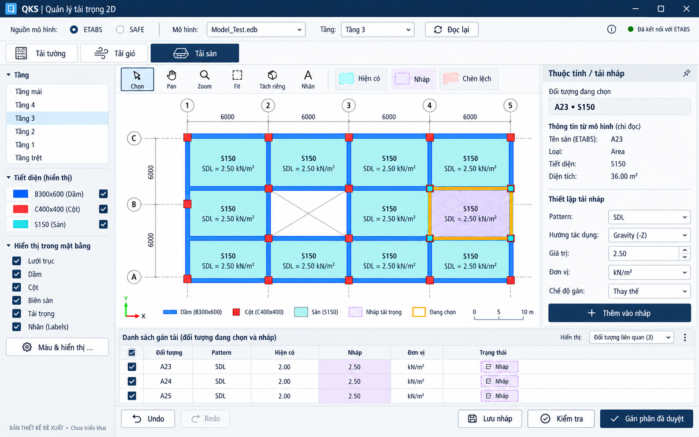
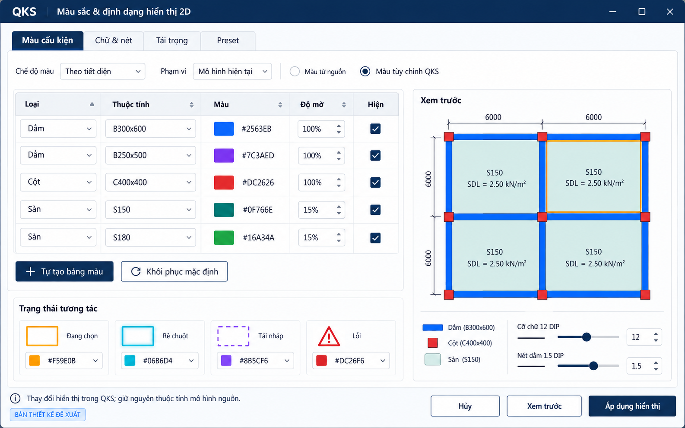

# Hình minh họa giao diện QKS 2D — QKS Navy

Hai hình dưới là **bản thiết kế đề xuất**, chưa phải giao diện phần mềm đã triển khai. Dữ liệu mô hình trong ảnh chỉ để minh họa.

## Template đã điều chỉnh

Headbar navy tối #0B1F3A; nút chính/tab active #102A4C, chữ trắng; secondary trắng/viền navy. Nút giữ hình chữ nhật với CornerRadius 3 DIP. Màu mô hình và ký hiệu tải giữ ý nghĩa riêng. Đây là chỉnh sửa thiết kế minh họa, chưa áp theme vào add-in chạy thực.

[Design tokens QKS Navy](qks-navy-tokens.json).

## 1. Bố cục cửa sổ WPF

Kết nối ETABS/SAFE, ba tab tải tường/gió/sàn, cây tầng và layer bên trái, viewport 2D ở giữa, thuộc tính/tải nháp bên phải, bảng thay đổi và tác vụ phía dưới.

[Mở file ảnh kích thước gốc](01-layout-wpf-2d.png)

## 2. Quản lý màu sắc và định dạng

Màu theo thuộc tính cấu kiện, độ đục, phạm vi áp dụng và preview. Hover/selection/nháp/lỗi có các dấu hiệu riêng.

[Mở file ảnh kích thước gốc](02-display-style-manager.png)

## Mở hoặc lưu ảnh

- Trang README này hiển thị hai ảnh trực tiếp.
- Bấm vào ảnh hoặc liên kết bên dưới để xem file gốc.
- Nếu đang ở trang file GitHub, chọn Raw/Download raw file để mở PNG; trình duyệt có thể lưu bằng Save image as.
- Cả hai ảnh có kích thước 1586 × 992, định dạng PNG RGB.

[Kế hoạch và quy định định dạng chi tiết](../PLAN-2D-LOAD-WORKSPACE.md).
