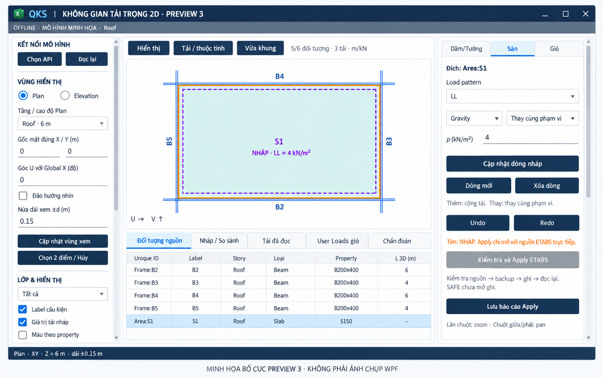
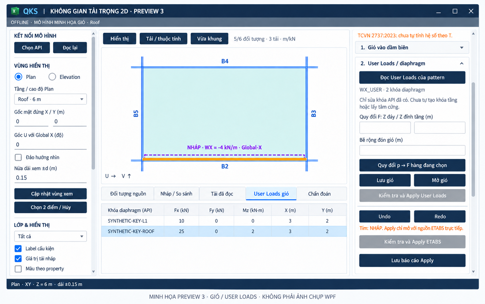
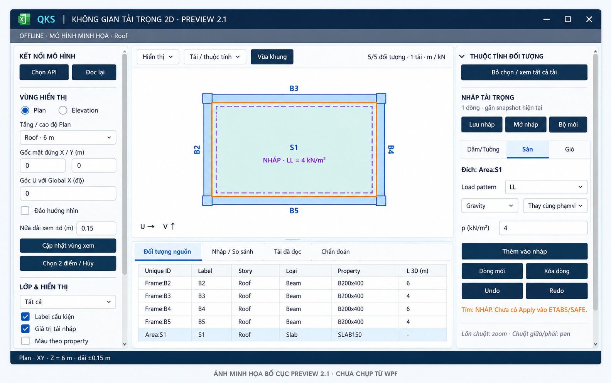

# Hình minh họa giao diện QKS 2D — QKS Navy

## Bố cục Preview 3 hiện tại

Hai ảnh dưới được **AI tạo để minh họa bố cục theo mã Preview 3**, không phải ảnh chụp ứng dụng WPF đang chạy trên Windows. Mô hình, tải và khóa diaphragm là dữ liệu nhân tạo; chi tiết hình học, chữ, khoảng cách và trạng thái control có thể khác khi chạy thực tế. Panel tải được minh họa ở vị trí đã cuộn xuống để thấy các thao tác phía dưới.

### Tổng thể và soạn tải sàn

[Mở hoặc tải PNG tổng thể](04-preview-3-workspace-illustration.png).

Headbar navy gọn, điều khiển Material Design, vùng Plan, bảng đối tượng và editor sàn. Nút Apply được minh họa ở trạng thái vô hiệu hóa vì nguồn là offline.

### Gió và bảng User Loads

[Mở hoặc tải PNG Gió / User Loads](05-preview-3-user-wind-illustration.png).

Minh họa nháp tải đường trên dầm biên, bảng Fx/Fy/Mz/X/Y và mục User Loads/diaphragm. Các khóa SYNTHETIC-KEY-* không phải định dạng khóa ETABS đã xác minh. Chưa có engine tự tính TCVN 2737:2023, tự lấy tâm cứng hoặc adapter live SAFE; ảnh không thể hiện các phần này đã hoàn tất. [Báo cáo triển khai và giới hạn kiểm thử](../VIEWER-PREVIEW-3.md).

## Bố cục sau cập nhật Preview 2.1

Ảnh dưới là **ảnh minh họa được tạo bằng AI theo bố cục XAML Preview 2.1**, không phải ảnh chụp WPF đang chạy. Mô hình Roof và tải trong ảnh là dữ liệu minh họa; hình học, chữ và khoảng cách có thể khác khi chạy trên Windows.

[Mở hoặc tải PNG gốc](03-preview-2.1-layout-illustration.png).

Ảnh thể hiện headbar navy gọn chỉ giữ nút cửa sổ; tác vụ kết nối chuyển sang panel trái; tab Dầm/Tường, Sàn, Gió dùng kiểu QKS; bảng không hiển thị cột; bố cục ba vùng và bảng dưới được thu gọn. Gió và adapter SAFE vẫn đang phát triển. [Chi tiết thay đổi, kết quả build/test và giới hạn kiểm tra Windows](../VIEWER-PREVIEW-2.1.md).

## Bản thiết kế ban đầu

Hai ảnh 01/02 bên dưới là **bản thiết kế đề xuất ở giai đoạn lập kế hoạch**. Mô tả ở phần này ghi lại thiết kế tại thời điểm đó, không thay thế trạng thái triển khai trong báo cáo Preview 2.1. Dữ liệu mô hình chỉ để minh họa; hai ảnh thể hiện Plan.

## Template đã điều chỉnh

Headbar navy tối #0B1F3A; nút chính/tab active #102A4C, chữ trắng; secondary trắng/viền navy. Nút giữ hình chữ nhật với CornerRadius 3 DIP. Màu mô hình và ký hiệu tải giữ ý nghĩa riêng. Đây là chỉnh sửa thiết kế minh họa, chưa áp theme vào add-in chạy thực.

[Design tokens QKS Navy](qks-navy-tokens.json).

## 1. Bố cục cửa sổ WPF

Kết nối ETABS/SAFE, ba tab tải tường/gió/sàn, cây tầng và layer bên trái, viewport 2D ở giữa, thuộc tính/tải nháp bên phải, bảng thay đổi và tác vụ phía dưới.

[Mở file ảnh kích thước gốc](01-layout-wpf-2d.png)

## 2. Quản lý màu sắc và định dạng

Màu theo thuộc tính cấu kiện, độ đục, phạm vi áp dụng và preview. Hover/selection/nháp/lỗi có các dấu hiệu riêng.

[Mở file ảnh kích thước gốc](02-display-style-manager.png)

## Mở hoặc lưu ảnh

- Trang README này hiển thị các ảnh trực tiếp.
- Bấm vào ảnh hoặc liên kết bên dưới để xem file gốc.
- Nếu đang ở trang file GitHub, chọn Raw/Download raw file để mở PNG; trình duyệt có thể lưu bằng Save image as.
- Ảnh 01/02 có kích thước 1586 × 992; hai ảnh Preview 3 có kích thước 1584 × 993, định dạng PNG RGB.

[Kế hoạch và quy định định dạng chi tiết](../PLAN-2D-LOAD-WORKSPACE.md).
